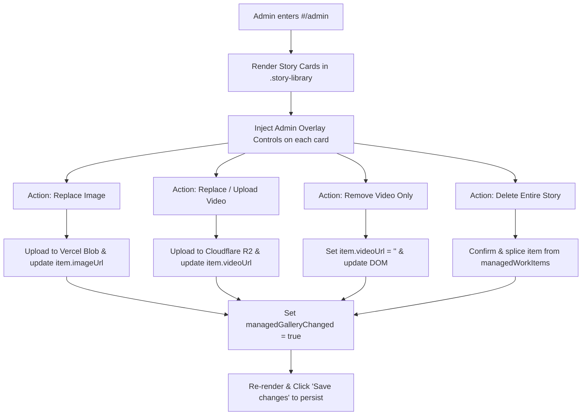

# Work Page Media Management — Senior Developer Architectural Analysis & Implementation Plan

## 1. Executive Summary & Webpage Analysis

The **EVR Work Page** (`index.html#/work` — *Selected Wedding Stories*) is structured into two main layers:
1. **Default Showcase Elements:**
   - A **Featured Wedding Film** wide-banner at the top (`.wide-story`).
   - Category filters: `All stories`, `Wedding day`, `Before the day`, `Celebrations`.
   - Initial 4 portfolio story cards dynamically rendered by `r2-video-library.js` inside `.story-library`.
2. **Admin-Managed Story Cards (`managedWorkItems`):**
   - Stored in a unified JSON payload (`#work-gallery-items-v1`) in Vercel Blob storage (`/api/content`).
   - Appended dynamically into `.story-library` as `<article class="admin-managed-work-item">` by `admin.js`.
   - Each item holds:
     ```typescript
     interface ManagedWorkItem {
       id: string;          // UUID
       title: string;       // Max 80 chars
       category: 'wedding' | 'prewedding' | 'celebration';
       description: string; // Max 240 chars
       imageUrl: string;    // HTTPS URL or empty when the story is video-only
       videoUrl: string;    // HTTPS URL or empty; at least one media URL is required
     }
     ```

---

## 2. Current Gaps & Why "Remove" and "Replace" Currently Fail

| Capability | Current Status | Cause in Codebase |
| :--- | :--- | :--- |
| **Add Story Card** | Working | Handled by `#admin-work-controls` in `admin.js`. |
| **Remove / Delete Story Card** | **Missing** | There is **no delete button** anywhere on the cards or in admin controls. No deletion handler exists for `managedWorkItems`. |
| **Replace Story Cover Image** | **Broken** | The generic "Replace photo" tool mutates DOM `img.src` based on CSS selectors. When the page reloads, `renderManagedWorkItems()` re-creates DOM elements using the old `imageUrl` stored in `managedWorkItems`. The change is lost. |
| **Remove Video from a Card** | **Missing** | Once a video URL is assigned to an item, there is no UI action to detach it or revert to an image-only card. |
| **Replace Video on a Card** | **Fragile** | The generic "Replace video" dropdown targets DOM elements, not the `managedWorkItems` array entry. |

---

## 3. Step-by-Step User Guide (How to Add Today)

Until the full replacement/deletion suite is coded, here is how an admin currently adds a story:

1. **Open the Admin Editor:**
   - Navigate to `http://localhost:3000/#/admin` (or your deployed URL `/#/admin`).
2. **Select the Work Page:**
   - In the top admin bar, set **Preview page** to **"Selected work"**.
   - The form titled **"Add a celebration story"** will appear.
3. **Fill Story Details:**
   - **Story title**: e.g., *Ananya & Siddharth Wedding*
   - **Story type**: Choose `Wedding day`, `Before the day`, or `Celebration`.
   - **Short description**: A 1-2 sentence caption.
   - **Story media**: Choose **Image** or **Video** first. Only the matching file picker is shown, so an image is not required for a video story.
   - **Image**: Choose a JPG, PNG, WebP or GIF up to 30 MB. It is optimized and uploaded to Vercel Blob.
   - **Video**: Choose a supported video up to 1 GB. It uploads to Cloudflare R2 and is used as the story media.
   - An image story can have a video added later using its card controls.
4. **Submit Card:**
   - Click **"Upload and add story"**. Wait for the upload progress bar to finish.
5. **Publish to Shared Website:**
   - Click the gold **"Save changes"** button in the top admin toolbar.

---

## 4. Implementation Plan: Complete Media & Card Management

To give admins total control (Add, Remove, Replace Image, Replace/Remove Video, and In-Place Edits), we implement direct action badges onto each story card while in Admin mode.



### Phase 1: Card Admin UI Overlay (HTML/CSS)
In `admin.css`:
- Add `.admin-card-actions` toolbar that only appears when `body.admin-active` is present:
  - 🗑 **Delete Story**: Destructive red badge.
  - 🖼 **Replace Cover**: Triggers an isolated file picker targeted to this specific item ID.
  - 🎬 **Attach / Replace Video**: File picker targeting this item's `videoUrl`.
  - ✕ **Remove Video**: Appears only if `item.videoUrl` is present.

### Phase 2: Card Operations in `admin.js`
In `admin.js`:
1. **Extend `createManagedWorkCard(item)`**:
   - Append the `.admin-card-actions` container to every managed card when admin is authenticated.
2. **Implement Item Deletion**:
   ```javascript
   function deleteManagedWorkItem(id) {
     if (!confirm('Are you sure you want to remove this story?')) return;
     managedWorkItems = managedWorkItems.filter(item => item.id !== id);
     managedGalleryChanged = true;
     renderManagedWorkItems();
     setStatus('Story removed. Click "Save changes" to publish.');
   }
   ```
3. **Implement Isolated Image Replacement**:
   ```javascript
   async function replaceManagedWorkImage(id, file) {
     setStatus('Uploading replacement image...');
     const imageUrl = await uploadPhotoFile(file);
     const item = managedWorkItems.find(it => it.id === id);
     if (item) {
       item.imageUrl = imageUrl;
       managedGalleryChanged = true;
       renderManagedWorkItems();
       setStatus('Image replaced. Click "Save changes" to publish.');
     }
   }
   ```
4. **Implement Isolated Video Replace & Removal**:
   ```javascript
   async function replaceManagedWorkVideo(id, file) {
     setStatus('Uploading replacement video to Cloudflare R2...');
     const uploaded = await uploadR2Video(file, progressCallback);
     const item = managedWorkItems.find(it => it.id === id);
     if (item) {
       item.videoUrl = uploaded.playbackUrl;
       managedGalleryChanged = true;
       renderManagedWorkItems();
       setStatus('Video replaced. Click "Save changes" to publish.');
     }
   }

   function removeManagedWorkVideo(id) {
     const item = managedWorkItems.find(it => it.id === id);
     if (item) {
       item.videoUrl = '';
       managedGalleryChanged = true;
       renderManagedWorkItems();
       setStatus('Video removed from story. Click "Save changes" to publish.');
     }
   }
   ```

### Phase 3: Built-in Showcase Card Management (Optional Hide/Override)
- For the 4 default template cards loaded by `r2-video-library.js`:
  - Add support for a `hiddenBuiltInCards: string[]` list in the saved content.
  - Allows an admin to hide default dummy showcase cards without modifying raw JS files.

---

## 5. Summary of Verification Steps
1. Navigate to `#/admin` -> select "Selected work".
2. Add an image story and a video-only story separately -> Click **Save changes** -> Refresh page -> Verify both media types persist without requiring both files.
3. On that card, click **Replace Cover** -> Select new picture -> Verify instant preview -> Click **Save changes** -> Refresh page -> Verify new picture remains.
4. On that card, click **Remove Video** -> Verify video controls vanish and only photo remains -> Click **Save changes** -> Refresh page.
5. Click **Delete Story** -> Accept confirmation -> Verify card is removed -> Click **Save changes** -> Refresh page -> Verify card is gone.
